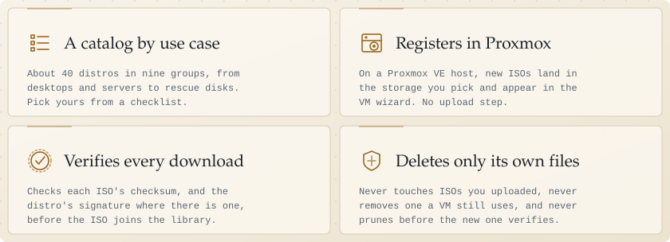
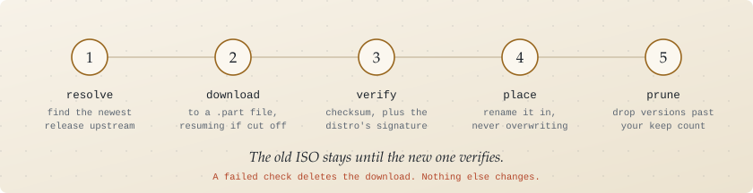
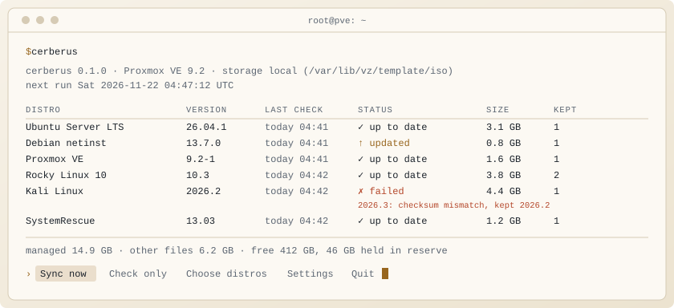

<picture>
  <source media="(prefers-color-scheme: dark)" srcset="./assets/hero-dark.svg">
  <source media="(prefers-color-scheme: light)" srcset="./assets/hero-light.svg">
  
</picture>

<p align="center">
  <a href="#what-it-does">What it does</a> &bull;
  <a href="#how-a-sync-works">How a sync works</a> &bull;
  <a href="#install">Install</a> &bull;
  <a href="#first-run">First run</a> &bull;
  <a href="#commands">Commands</a> &bull;
  <a href="#the-catalog">Catalog</a> &bull;
  <a href="#safety">Safety</a>
</p>

<br>

cerberus keeps a library of Linux installer ISOs current. You pick distros
from a catalog sorted by use case. Then, on a schedule, cerberus checks each
one for a new release and downloads it. It checks the checksum and signature,
and only then adds the ISO to the library. On a Proxmox VE host, the ISOs go
into a storage you choose and show up in the VM wizard. Anywhere else, they go
in a folder you choose.

> **Pre-release.** cerberus is being built now, and this page describes v0.1
> as designed. The install command works once the first release is tagged.

<p align="center">
  <picture>
    <source media="(prefers-color-scheme: dark)" srcset="./assets/divider-dark.svg">
    <source media="(prefers-color-scheme: light)" srcset="./assets/divider-light.svg">
    
  </picture>
</p>

## What it does

<picture>
  <source media="(prefers-color-scheme: dark)" srcset="./assets/features-dark.svg">
  <source media="(prefers-color-scheme: light)" srcset="./assets/features-light.svg">
  
</picture>

<details>
<summary><strong>How it tells what kind of host it's on</strong></summary>
<br>

| It finds | It treats the host as | ISOs go to |
|---|---|---|
| `/etc/pve` and `pvesh` | a Proxmox VE host | a PVE storage's ISO folder. It lists the active storages and suggests `local`. |
| Samba shares or NFS exports | a file server | a folder you choose. It suggests `isos/` under each share. |
| neither | a Linux box | a folder you choose. It suggests `/srv/isos`. |

</details>

## How a sync works

<picture>
  <source media="(prefers-color-scheme: dark)" srcset="./assets/flow-dark.svg">
  <source media="(prefers-color-scheme: light)" srcset="./assets/flow-light.svg">
  
</picture>

Every selected distro goes through the same five steps. If a check fails,
cerberus deletes the download and keeps the version you already had. A bad
mirror or a half-published release never costs you a working ISO. The
failure shows on the status screen and, if you've set it up, in an ntfy alert.

## What it looks like

<picture>
  <source media="(prefers-color-scheme: dark)" srcset="./assets/status-dark.svg">
  <source media="(prefers-color-scheme: light)" srcset="./assets/status-light.svg">
  
</picture>

Running `cerberus` with no arguments prints this screen. In a terminal, a
menu follows. Piped or in a script, it prints and exits.

## Install

Run this as root, since Proxmox hosts don't have sudo by default. It
downloads the binary and the release's checksum file, checks one against the
other, and installs the binary:

```bash
cd /tmp && curl -fsSL --remote-name-all https://github.com/successful-accident/cerberus/releases/latest/download/{cerberus-linux-amd64,SHA256SUMS} && sha256sum --ignore-missing -c SHA256SUMS && install -m 0755 cerberus-linux-amd64 /usr/local/bin/cerberus
```

On ARM, use `cerberus-linux-arm64`. With Go 1.26 or later you can build it
instead:

```bash
go install github.com/successful-accident/cerberus/cmd/cerberus@latest
```

## First run

<table>
<tr>
<td width="50%" valign="top">

### On Proxmox VE

Run `cerberus`. It sees `/etc/pve`, lists the storages that hold ISOs, and
suggests `local`. Pick your distros and it offers a first sync.

New ISOs go into that storage's ISO folder, so they're in the VM wizard
right away. Before every write, it asks PVE whether the storage is still
active, so an unmounted NFS share can't fill the boot disk.

</td>
<td width="50%" valign="top">

### On a file server or any Linux box

Run `cerberus`. It asks where your ISO folder lives, and suggests one under
each Samba or NFS share it finds. Each distro gets its own subfolder, and
`latest/` holds a link to the newest ISO of each.

To change the folder later, run `cerberus location set <dir>`. On the same
disk, cerberus just renames the files. Otherwise it copies each file, checks
it, and then removes it from the old folder.

</td>
</tr>
</table>

## Commands

| Command | What it does |
|---|---|
| `cerberus` | the status screen, with a menu in a terminal |
| `cerberus init` | first-run setup; every question also has a flag |
| `cerberus select` | pick distros from a checklist; `add` and `remove` do it from scripts |
| `cerberus keep <id> <n>` | keep the newest `n` versions of a distro (the default is 1) |
| `cerberus pin <id> <prefix>` | hold a distro to one series, as in `pin ubuntu-server-lts 24.04` |
| `cerberus sync` | check and update everything now; `check` only reports |
| `cerberus catalog` | browse the catalog; `catalog check` tests entries against the live feeds |
| `cerberus location set` | move the library to another folder or PVE storage |
| `cerberus schedule install` | sync every day, by default at 04:30 |
| `cerberus settings` | change any of the above interactively |

## The catalog

The catalog has about 40 distros in nine groups, written as 45 entries. A few
distros have a separate arm64 entry, because they publish it on a different
host.
`cerberus catalog` prints the current list.

| Use case | Distros |
|---|---|
| Desktop | Ubuntu Desktop LTS, Kubuntu LTS, Fedora Workstation, Fedora KDE Plasma, Linux Mint Cinnamon, Pop!_OS, Debian Live (GNOME), openSUSE Leap, CachyOS, EndeavourOS |
| Gaming | Bazzite |
| Server | Ubuntu Server LTS, Debian netinst, Rocky Linux 10, AlmaLinux 10, CentOS Stream 10, Fedora Server |
| Homelab | Proxmox VE, Proxmox Backup Server, XCP-ng, TrueNAS Community Edition, openmediavault |
| Containers | Talos Linux, Fedora CoreOS |
| Security and privacy | Kali Linux, Parrot Security, Tails, Qubes OS |
| Rescue | SystemRescue, GParted Live, Clonezilla Live, Rescuezilla, netboot.xyz, ShredOS |
| Lightweight | Alpine Linux (standard and virt), MX Linux, Void Linux |
| DIY and rolling | Arch Linux, Gentoo, NixOS, openSUSE Tumbleweed |

cerberus checks every ISO against its distro's published checksum. Most
entries also verify the distro's OpenPGP signature. The exceptions:
- Pop!_OS, CentOS Stream, Bazzite, Talos, Rescuezilla, ShredOS,
  netboot.xyz, Void and NixOS publish no OpenPGP signature.
- XCP-ng signs with SHA-1, which cerberus rejects.
- openSUSE Tumbleweed uses version 3 signatures, which cerberus doesn't read
  yet.
- MX Linux's signing key isn't listed anywhere official.

Each entry is a short recipe in [`catalog/`](./catalog), and you can add
your own ([Add a distro](#add-a-distro)).

## Safety

cerberus:
- downloads only over HTTPS, redirects included;
- checks every ISO against the sha256 or sha512 the distro publishes before
  it joins the library. Where the distro also signs its releases, it checks
  that signature against keys pinned in the catalog;
- leaves alone every file it didn't download. If you uploaded the same ISO
  yourself, it uses your copy and never deletes it;
- keeps any ISO that a Proxmox VM's config still points at;
- keeps 10% of the disk free, at least 10 GB, and stops if the disk fills;
- never downgrades. If upstream's newest version is older than yours, it
  says so and waits;
- runs one sync at a time, and manages a library from one host only.

## Schedule and alerts

`cerberus schedule install` sets up a systemd timer that syncs daily at
04:30. The timer adds up to an hour of random delay, so mirrors aren't all hit
on the hour. If the host was off at sync time, the sync runs after the next
boot.
`--at 02:15` picks a different time. Without systemd, it writes
`/etc/cron.d/cerberus` instead.

For alerts, put an [ntfy](https://ntfy.sh) topic in
`/etc/cerberus/ntfy-topic` with mode 0600, or point
`cerberus init --ntfy-topic-file` at a file you keep elsewhere. cerberus
sends a summary whenever a sync updates or fails something. That includes a
sync that can't start, such as on an unmounted storage. The topic never goes
in the config file or the logs, because anyone who knows it can read your
alerts.

## Add a distro

Drop a YAML file in `/etc/cerberus/catalog.d/`, written like the ones in
[`catalog/`](./catalog). An entry with the same `id` as a built-in one
replaces it. This one finds the newest Ubuntu LTS:

```yaml
- id: ubuntu-server-lts
  name: Ubuntu Server LTS
  category: server
  arch: {amd64: amd64}
  steps:
    - fetch: https://releases.ubuntu.com/
      match: 'href="(?P<version>\d[02468]\.04(?:\.\d+)?)/"'
    - fetch: https://releases.ubuntu.com/{version}/SHA256SUMS
      match: '(?m)^(?P<sha256>[0-9a-f]{64}) \*(?P<file>ubuntu-(?P<version>[\d.]+)-live-server-{arch}\.iso)$'
  url: https://releases.ubuntu.com/{version}/{file}
```

Each step fetches a page and pulls candidates out of it. It uses a regex
(regular expression), or a jq program for JSON and YAML feeds. Named groups become variables for
later steps, and the highest `version` wins. A step can also read a redirect
target or a header, skip betas with `exclude:`, or verify a clearsigned
checksum file. Then test it:

```bash
cerberus catalog check ubuntu-server-lts
```

## How the catalog stays honest

Distros move their files around. Once a week, a GitHub Actions job runs
`cerberus catalog check` against every entry. A broken recipe fails in CI
before it can fail your nightly sync.

## License

[GPL-3.0](./LICENSE).

<details>
<summary><strong>About the look</strong></summary>
<br>

This README shares its look with a small family of homelab repos: Palatino
and mono, a Greek-key border, bronze for live work and ember for failures.
The hero draws cerberus as three heads over the gate of the ISO library.
Watch finds new releases, fetch downloads them, and verify checks each
checksum and signature before an ISO comes through. Every picture is plain
SVG, with a dark and a light version.

</details>

<br>

<p align="center"><sub>cerberus isn't affiliated with Proxmox Server Solutions GmbH or with any distro it downloads. Proxmox is a registered trademark of Proxmox Server Solutions GmbH.</sub></p>
